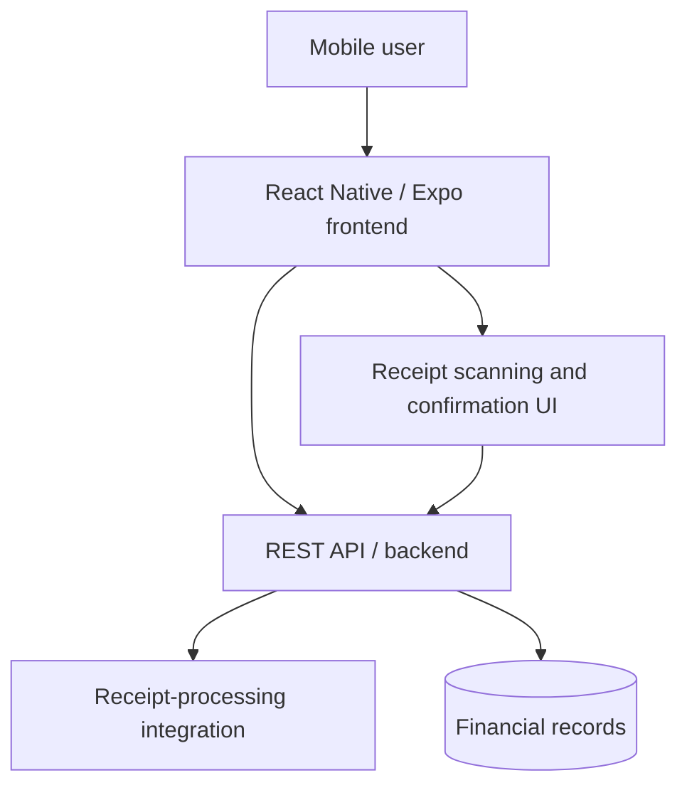

Mobile Financial Management App — Architecture, AI Scan Integration & Quality Assurance
Team project | React Native / Expo | REST APIs | JavaScript | Jest | Git

This repository is a personal engineering portfolio and evidence index, not a copy of the application source code. It documents my contributions to system design, API contracts, task coordination, integration, automated testing, and AI-assisted receipt-scanning workflows in a team-developed financial management application.
Attribution: I coordinated technical work and contributed code, testing, and integration. Other team members implemented parts of the application, including the initial AI Scan service and hook. The original repositories and Git history retain their authorship.

Project overview
The application was designed around financial-management workflows including dashboards, transactions, categories, budgets, reports, and receipt scanning. Its receipt-scanning workflow accepts a receipt image, communicates with a backend processing service, and supports confirmation of a resulting financial transaction.

Original project repositories
- Team frontend — FinancialManagement1/fm-frontend
- Backend/API repository — amilawedikkara/moneytracker-api
My role and responsibilities
Area	My contribution
System design	Defined planned module boundaries and integration responsibilities across Dashboard, Transactions, Categories, Budget, Reports, and AI Scan.
API contracts	Specified expected request/response structures, data types, validation requirements, and frontend–backend integration behaviour.
Task coordination	Broke down requirements and assigned implementation tasks to teammates; clarified expected outcomes and integration interfaces.
Implementation review	Inspected delivered work, tested behaviour, investigated defects, and coordinated fixes before integration.
Git integration	Coordinated feature branches and pull-request merges across application modules.
Direct technical contributions	Fixed receipt-scan confirmation integration, corrected an API endpoint mismatch, strengthened response validation, and added automated tests.

Design, delegation, and informal code-review responsibilities are described from my project role; Git history does not independently record every design decision or review discussion.
Architecture and integration context

This is a conceptual integration diagram, not a verified deployment diagram. It deliberately does not assert which OCR/AI model or cloud service processed receipts.
Key integration requirements
- Consistent request and response structures across frontend and backend.
- Input validation and predictable handling of malformed responses.
- Authenticated API communication and appropriate error handling.
- Clear separation between receipt scanning, user confirmation, and transaction creation.
- Testable interfaces between independently developed modules.
Engineering evidence — selected merged pull requests
Evidence	Issue addressed	What it demonstrates
PR #7 — Scan and transaction confirmation	Resolved an API documentation/implementation mismatch; used the working POST /transactions endpoint and documented validation with Swagger and Postman (201 Created).	API contract troubleshooting, integration debugging, backend verification
PR #16 — Strict scanId validation	Enforced non-empty string validation; added tests for missing/wrong-type IDs, empty or invalid responses, nested responses, network errors, and HTTP errors.	Defensive programming, negative testing, AI-feature API boundary validation
PR #6 — Transaction integration	Integration changes to transaction navigation, add/edit flows, and screen refresh behaviour.	Cross-component integration
PR #2 — Dashboard integration	Dashboard, API service, authentication, and related test files changed together.	Frontend–service integration and test coordination
PR #9 — Budget logic and PR #10 — Budget UI	Integration of budget logic and user interface workstreams.	Coordinating related feature branches
PR #11 — Reports logic and PR #12 — Reports UI	Separate reports logic and UI integration.	Module-level workstream integration

In the supplied repository PR listing, 15 of 17 PR records identify my GitHub account as the PR author and merger. That is evidence of repository integration activity, not a claim that I wrote all code in those PRs or formally approved every change. The inspected PRs did not have recorded formal GitHub review submissions.
AI-assisted receipt scanning: my quality focus
The receipt-scanning feature illustrates the difference between integrating an AI-enabled capability and validating an AI model itself.

What I worked on and can demonstrate:
- Connecting the scan and transaction-confirmation flow to the working backend API.
- Identifying and correcting a documented endpoint mismatch.
- Rejecting invalid scanId values instead of accepting any truthy value.
- Testing malformed responses, unexpected response structures, network failures, and HTTP errors.
- Supporting a workflow in which extracted information can be checked before a transaction is confirmed.
What this evidence does not establish: OCR extraction accuracy, hallucination rates, model fairness, RAG evaluation, or production LLM/agent validation. The available PR evidence primarily demonstrates application/API quality assurance around an AI-assisted feature.
Testing approach
Testing work in the frontend includes JavaScript/Jest tests, service behaviour, hooks, and API-boundary error handling. For example, PR #16 documents negative test cases for the scan service.

I do not present a numeric overall test-coverage percentage here because a reproducible coverage report for a specific commit and test configuration has not yet been verified.
Collaboration and ownership
The project used separate workstreams for UI, logic, and integration. My responsibilities included translating requirements into tasks, explaining interfaces and expected data shapes, reviewing delivered behaviour, and bringing work together through Git branches and PRs.

Team contributions remain attributed to their authors. In particular, the initial scanService and useAiScan implementation appears in a commit by another contributor; my directly attributable commits include later integration fixes, validation, stabilization, and tests.
Relevance to software quality engineering
This project demonstrates practical experience with:
- System integration testing: finding gaps between API documentation and actual runtime behaviour.
- API validation: checking response types, missing fields, error handling, and failure paths.
- Test automation: adding and maintaining service/hook tests.
- Technical coordination: defining responsibilities and integrating work from multiple contributors.
- AI-feature quality boundaries: preventing malformed service outputs from passing into downstream transaction logic.
Portfolio owner: Amila Iresh · LinkedIn

Source attribution: The application was developed as a team project. This repository describes my responsibilities and provides links to inspectable source and PR evidence; it is not a claim of sole ownership.
