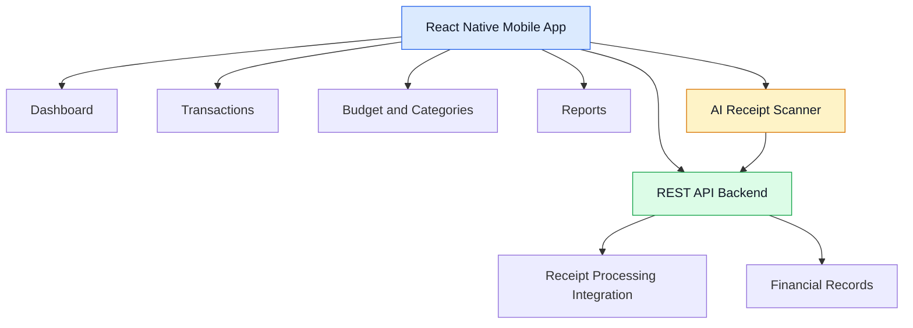
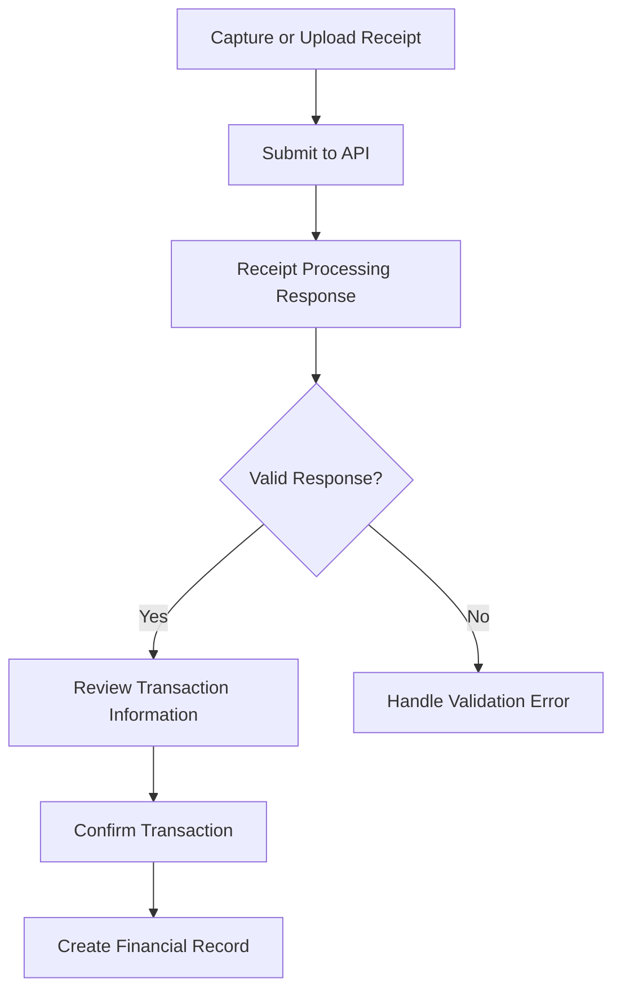

# Mobile Financial Management App

### System Architecture | API Integration | AI Receipt Scanning | Quality Assurance

**Role:** System Design, Technical Coordination, API Integration & Testing
**Project:** Team-developed React Native / Expo application

---

## Project Overview

A cross-platform financial management application developed as a team project.

The application includes:

- Dashboard and financial analytics
- Transaction management
- Categories and expense tracking
- Budget management
- Reports and visualization
- AI-assisted receipt scanning

**My main responsibility was designing the system, defining API contracts, coordinating implementation tasks, reviewing delivered functionality, testing integrations, and managing Git integration.**

I also contributed code directly to receipt-scanning integration, input validation, and automated testing.

### Source Repositories

- [Team Frontend Repository](https://github.com/FinancialManagement1/fm-frontend)
- [Backend API Repository](https://github.com/amilawedikkara/moneytracker-api)

---

## System Architecture

The following diagram illustrates the application's main integration boundaries.

*Conceptual architecture: the exact receipt-processing model and infrastructure are not independently verified here.*

---

## My Engineering Contributions

| Area | Responsibilities |
|---|---|
| **System Architecture** | Defined application modules, responsibilities, and integration boundaries |
| **API Design** | Specified expected request and response structures, data types, and validation requirements |
| **Technical Coordination** | Distributed implementation tasks and clarified expected outcomes for teammates |
| **Implementation Review** | Inspected delivered functionality, investigated integration problems, and coordinated corrections |
| **Quality Assurance** | Validated API behaviour, tested error scenarios, and contributed automated tests |
| **Git Coordination** | Managed feature integration through branches and pull requests |
| **Direct Development** | Implemented receipt-scanning integration fixes, validation improvements, and test cases |

The project was developed collaboratively. My system design and coordination responsibilities are described separately from code authored by other contributors.

---

## AI-Powered Receipt Scanning

The AI Scan feature allows users to submit receipt images and process the results through a transaction confirmation workflow.

### Integration Workflow

### My Technical Contributions

- Investigated and corrected API endpoint mismatches.
- Integrated receipt scanning with transaction confirmation.
- Added stricter validation for `scanId`.
- Tested malformed API responses and unexpected data types.
- Added negative test cases for HTTP and network errors.
- Coordinated scanner functionality with other application modules.

**Important distinction:** These contributions demonstrate quality assurance around an AI-assisted application feature. They do not establish that I developed or independently validated the underlying OCR/AI model.

---

## Verified GitHub Pull Request Evidence

The following merged pull requests provide examples of my integration, testing, and Git coordination work.

| PR | Description | Engineering Evidence |
|---|---|---|
| [#2](https://github.com/FinancialManagement1/fm-frontend/pull/2) | Dashboard integration | Frontend, authentication, services, and testing |
| [#6](https://github.com/FinancialManagement1/fm-frontend/pull/6) | Transaction integration | Navigation, transaction forms, and workflow fixes |
| [#7](https://github.com/FinancialManagement1/fm-frontend/pull/7) | AI Scan confirmation | API endpoint correction and Swagger/Postman validation |
| [#9](https://github.com/FinancialManagement1/fm-frontend/pull/9) | Budget logic | Feature integration |
| [#10](https://github.com/FinancialManagement1/fm-frontend/pull/10) | Budget UI | UI integration |
| [#11](https://github.com/FinancialManagement1/fm-frontend/pull/11) | Reports logic | Module integration |
| [#12](https://github.com/FinancialManagement1/fm-frontend/pull/12) | Reports UI | UI integration |
| [#16](https://github.com/FinancialManagement1/fm-frontend/pull/16) | AI Scan validation | Strict response validation and automated tests |
| [#17](https://github.com/FinancialManagement1/fm-frontend/pull/17) | Reports improvements | UI improvements and integration |

### Git Integration Evidence

In the retrieved repository PR listing:

- **17 pull requests** were listed.
- **15 PRs** identified my GitHub account as their author.
- The same **15 PRs** identified my account as the merger.

These records demonstrate substantial integration activity, not sole authorship of all code in the merged branches.

Formal GitHub review approvals were not present in the four inspected PR records. Implementation checking and coordination are therefore described separately from formal review approvals.

---

## Quality Assurance and Test Automation

My QA work emphasized service integration, response validation, and failure handling.

### AI Scan Validation Scenarios

The documented tests include:

| Test Scenario | Expected Behaviour |
|---|---|
| Missing `scanId` | Reject the response |
| Numeric `scanId` | Reject incorrect data type |
| Empty `scanId` | Reject invalid identifier |
| Empty response body | Handle gracefully |
| Invalid JSON response | Handle parsing failure |
| Nested response structure | Validate expected identifier |
| Network failure | Handle API failure |
| HTTP error | Handle unsuccessful response |

**Evidence:** [PR #16 - Strict Scan ID Validation](https://github.com/FinancialManagement1/fm-frontend/pull/16)

### API Integration Investigation

In [PR #7](https://github.com/FinancialManagement1/fm-frontend/pull/7), I documented an integration mismatch:

- The expected `/transactions/confirm` endpoint did not work in the target environment.
- The working endpoint was `POST /transactions`.
- The API behaviour was checked using Swagger and Postman.
- A `201 Created` response was documented.
- The frontend transaction confirmation flow was corrected.

This demonstrates API contract investigation and system integration debugging.

**Test coverage note:** An overall percentage is not claimed because a reproducible coverage report for a specific commit has not yet been verified.

---

## Technical Coordination and Collaboration

The project involved multiple contributors working on frontend UI, business logic, services, and integrations.

My responsibilities included:

1. Defining module boundaries and expected API behaviour.
2. Translating functional requirements into development tasks.
3. Assigning work and communicating expected outcomes.
4. Checking functionality delivered by team members.
5. Investigating issues across module boundaries.
6. Coordinating feature branches and pull request integration.
7. Supporting testing and defect correction.

The original GitHub repository preserves team contribution history and code authorship.

---

## Relevance to Quality Engineering

This project demonstrates experience in:

- **System Design:** Clear separation of responsibilities and integration interfaces.
- **System Integration Testing:** Investigating behaviour across frontend and backend boundaries.
- **API Quality Assurance:** Validating response structures, errors, and input constraints.
- **Test Automation:** Developing and maintaining automated tests.
- **AI Feature Integration:** Handling unexpected responses from AI-assisted functionality.
- **Technical Collaboration:** Coordinating development work and combining team contributions.

---

## MoneyTracker API Contract Design

I designed the MoneyTracker OpenAPI 3.1.0 specification, covering 11 API paths, 14 HTTP operations and 7 functional categories, including authentication, transactions, budgets and AI receipt scanning.

[View API Architecture and Contract Design](docs/api-contract-architecture.md)
## Connect

**Amila Iresh**
Information Technology Engineering Student | OAMK, Finland

[LinkedIn](https://www.linkedin.com/in/amilai/) | [GitHub Profile](https://github.com/amilawedikkara)

---

*This is a personal contribution portfolio for a team-developed project. It does not claim sole ownership of the application or the underlying AI/OCR implementation.*
