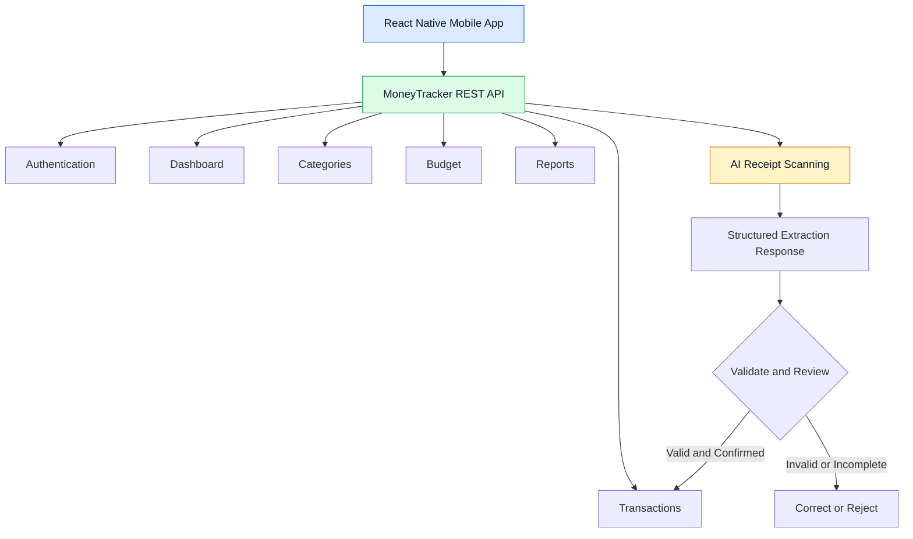

# MoneyTracker API — Architecture and Contract Design

**Designed by Amila Iresh | OpenAPI 3.1.0**

## Overview

I designed the API contracts for a team-developed React Native financial management application.

The specification defines:

| Metric | Value |
|---|---|
| API paths | 11 |
| HTTP operations | 14 |
| Functional categories | 7 |
| Authentication | JWT Bearer |
| API standard | OpenAPI 3.1.0 |

## API Architecture

This diagram represents the API contract and intended integration flow, not verified production infrastructure.

## My API Design Contributions

- Defined REST endpoint structures and request/response schemas.
- Designed JWT authentication requirements.
- Specified transaction and category validation rules.
- Defined budget calculation and validation requirements.
- Designed structured AI receipt-scanning responses.
- Defined extraction status, confidence fields and user confirmation requirements.
- Documented expected errors and response codes.

## Quality Assurance Considerations

The API design includes validation for:

- Required fields and data types.
- Transaction amounts and currency codes.
- Incorrect or missing identifiers.
- Malformed API responses.
- Failed or incomplete AI extraction.
- User confirmation before saving financial transactions.

## Contract and Implementation Differences

The original API contract included a separate transaction-confirmation endpoint.

During frontend integration, the team identified that the working implementation used a different endpoint.

This discrepancy was investigated and documented in [Frontend PR #7](https://github.com/FinancialManagement1/fm-frontend/pull/7).

Strict scan response validation was documented in [Frontend PR #16](https://github.com/FinancialManagement1/fm-frontend/pull/16).

## Scope

This documentation showcases my API architecture and contract-design responsibilities.

It does not claim that every specified endpoint was deployed, that I developed the underlying OCR model, or that the complete application was developed by me alone.
